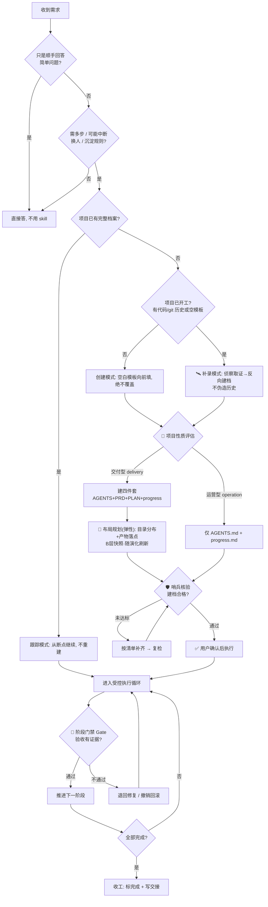
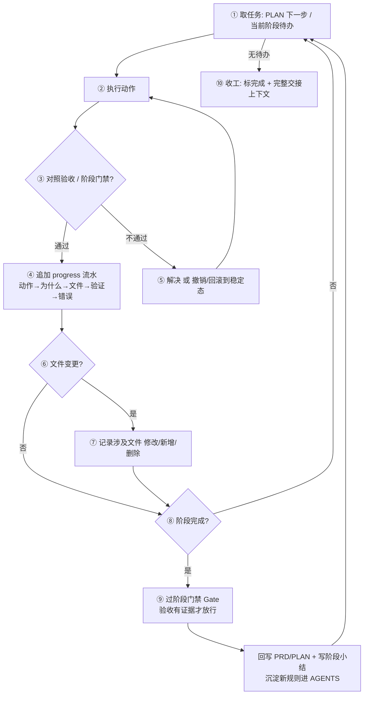

# project-plan-z · README

> 版本 v2.6.3（2026-11-01）

**单一规划 skill。** 需求确定后，为工作项目建立一套可读可控的档案，靠简单纪律保持进度可见、上下文可交接。不依赖任何 host 专属 hook，换任何支持 skill 的 host 都能用。


> 本文件是 skill 的文字版说明（由 `assets/EXECUTION_FLOW.html` 流程图转写）。流程图保留原样，可视版请看该 HTML。

> **还有一份可选的 `USAGE.md`（位于 skill 根）**，与本文件分工不同：本文件讲「skill 是什么 / 怎么走」（结构、流程、红线）；`USAGE.md` 讲「不同 agent / 不同工作区配置下怎么用才真正好用」——重点解决「为什么我的 AGENTS.md 没被遵守」这类落地问题（例如 WorkBuddy 只自动读 workspace folder 那一层 `AGENTS.md`、子文件夹不读，需用前设好工作目录）。**可选阅读，不强制加载**，不进 SKILL.md 常驻上下文，路由索引中作为「可选」项列出。

---

## 关于本 skill

### 核心能力

- **项目性质评估**：建档前先判交付型 / 运营型，决定生成四件套还是仅 `AGENTS.md + progress.md`（**不是所有项目都要四件套**）。
- **补录模式**：项目做到一半才用本 skill 时，档案反向侦查出来——侦察兵子 agent 盘点磁盘证据，信息源三级分级（磁盘证据 / agent 已知 / 待确认），progress 不伪造历史。
- **哨兵子 agent**：建档 / 补录完成后必过独立只读子 agent 核验（结构 / 状态真实 / 无编造），自查自评不算数。
- **四件套档案**：`AGENTS.md`（活规则库）、`PRD.md`（需求与验收）、`PLAN.md`（执行计划与阶段状态机）、`progress.md`（进度与交接）。
- **受控执行循环**：每完成一个动作 / 阶段即回写对应文件，直到收工；含异常场景兜底。
- **阶段门禁与审核精神**：验收默认不通过、须有证据；提交类守原子 / 约定式纪律。
- **非破坏性脚手架**：`scaffold.py` 只补缺失文件，已存在绝不覆盖；运营型可单向升级为交付型。
- **渐进式披露**：SKILL.md 只放地图与红线，详细规则按需从 `references/` 加载；项目自身 `AGENTS.md` 规则过多时同样拆 `AGENTS.d/` 子文件、按需加载。
- **文件布局规划（v2.6.0 新增）**：动手前想清目录分布与产物落点，且随项目结构演化持续刷新；规则与可变快照分离（A 层稳定规则进 AGENTS.md、B 层当前结构进 PLAN 架构段），布局是镜子不是笼子，更新快照不算破规则。

### 何时用 / 何时不用

- **用**：新项目起手、有产品意图、需沉淀项目规则、可能中断或换人接手的任务。
- **不用**：一步到位的简单修改、纯问答、一次性脚本。

### 文件结构

```
project-plan-z/
├── SKILL.md              # 地图 + 路由 + 红线纪律（常驻上下文）
├── README.md             # 文字版说明（结构 / 流程 / 红线，由流程图转写）
├── USAGE.md              # 可选：跨 agent 适配与使用诀窍（非强制加载）
├── assets/               # 脚手架模板（写入用户项目）
│   ├── AGENTS.md  PRD.md  PLAN.md  progress.md
│   ├── EXECUTION_FLOW.html  # 执行链路图（可视版，原样保留）
│   └── promo/             # 宣传图（AI 生图，无水印，见文末「视觉资产」）
├── references/           # 按需加载的详细规则
│   ├── generate-files.md     # 建档规则 + 合格标准
│   ├── file-layout.md       # 文件布局规划（规则与可变快照分离、弹性强度、变更刷新）
│   ├── plan-structuring.md   # 复杂度 + 自检 + 生命周期
│   ├── runtime-loop.md       # 执行循环 10 步
│   ├── change-sync.md        # PRD/PLAN/progress 变更同步
│   ├── progress-spec.md      # 进度与交接规范
│   ├── commit-discipline.md  # 提交纪律
│   ├── review-gates.md       # 阶段门禁 / 审核精神
│   └── example-filled.md     # 完整四件套范例
└── scripts/
    └── scaffold.py       # 非破坏性脚手架
```

---

## 1. 总执行链路（Master Flow）




---

## 2. 两种模式（建档前必做性质评估）

| 类型                | 特征                                            | 生成文件                                |
| ----------------- | --------------------------------------------- | ----------------------------------- |
| **交付型 delivery**  | 有明确定义的产物 + 验收标准 + 可收敛的执行路径（产品 / 功能 / 一次性工程）   | 四件套全建                               |
| **运营型 operation** | 长期、开放式、无单一交付物的持续任务（长期维护 / Chronic 任务 / 习惯养成类） | 仅 `AGENTS.md` + `.plan/progress.md` |

判定（任一"否"即运营型）：

1. 这项工作有可定义的最终交付物吗？
2. 能写出"做到什么程度算成功"的验收标准吗？
3. 它有可收敛的终点，还是长期持续？

- 运营型**不生成 PRD / PLAN**：硬写只会产生噪声与脱节。
- 运营型仍要 `AGENTS.md` 与 `progress.md`，保证跨会话连续。
- 类型可升级：运营型后期长出交付需求，再跑 `scaffold.py --type delivery`，只补缺失的 PRD/PLAN，不覆盖已有文件。

### 三种建档模式（何时用哪个）

| 模式     | 触发                             | 做法                                                                                   |
| ------ | ------------------------------ | ------------------------------------------------------------------------------------ |
| **创建** | 全新项目，还没开工                      | scaffold 非破坏生成骨架 → 空白模板向前填                                                           |
| **补录** | 项目已开工但缺档案（有代码 / git 历史或档案是空模板） | 侦察兵子 agent 盘点证据 → 反向撰写（信息源 L1 磁盘证据 / L2 agent 已知 / L3 待确认）→ progress 首条写「回溯建档」，不伪造历史 |
| **跟踪** | 档案完整                           | 读断点继续，不重建                                                                            |

创建 / 补录完成后**必过哨兵核验**（独立子 agent 按合格标准查结构 / 状态真实 / 无编造）；跟踪模式不强制。详见 `references/generate-files.md` 补录节与哨兵节。

---

## 3. 复杂度分级

| 级别     | 适用                 | 计划粒度                     |
| ------ | ------------------ | ------------------------ |
| **S**  | ≤3 文件，单领域，无外部依赖    | 直接列步骤，不必拆阶段，进度记 progress |
| **M**  | 4-15 文件，1-2 领域，有依赖 | PLAN 列阶段 + 步骤            |
| **L**  | 16+ 文件，多领域 / 多模块   | PLAN 分阶段 + 关键决策 + 验证     |
| **XL** | 跨系统、长期             | L + 每阶段独立评审门禁            |

---

## 4. 预执行自检（建档合格前必过）

- [ ] 完整性：需求 / 计划 / 验收无空项
- [ ] 可行性：技术路径可落地，无未解死结
- [ ] 风险：已识别主要风险并写缓解
- [ ] 安全违规：不引入越权 / 破坏 / 数据泄露
- [ ] 修改安全：对现有文件先备份 / 可回滚
- [ ] 死代码：改动无遗留无效调用 / 注册
- [ ] 可验证：每阶段有 pass/fail 判据与冒烟验证
- [ ] 依赖 / DAG：依赖已就绪或有序
- [ ] 对齐：与用户目标、已有文档一致

---

## 5. 生命周期阶段（9 阶段词表）

需求澄清 → 设计定稿 → 脚手架/初始化 → 核心实现 → 集成联调 → 测试验证 → 审查打磨 → 部署发布 → 交接归档

> 运营型项目不强调"部署发布 / 交接归档"的终点，循环往复。

---

## 6. 变更同步（PRD ↔ PLAN ↔ progress）

交付型三者任一变动，须联动另两端：

- PRD 变 → PLAN 阶段 / 验收同步、progress 记变更
- PLAN 变 → PRD 范围核对、progress 追加速度
- progress 暴露偏差 → 回写 PRD/PLAN，不带着脱节的计划继续

运营型无 PRD/PLAN，仅 `AGENTS.md ↔ progress.md` 同步。

---

## 7. 执行循环详图（10 步回路）



异常兜底（不裸奔）：

| 偏离                     | 处理                                |
| ---------------------- | --------------------------------- |
| 需求模糊 / 用户新需求           | 先澄清或回写 PRD，不带着误会继续                |
| 任务 BLOCKED（依赖未就绪 / 卡死） | PLAN 标 `BLOCKED`，先做不依赖部分          |
| 审查 / 验证发现严重问题          | 退回上一稳定阶段修复，重走验证闭环                 |
| 改动出错或触发安全违规            | 撤销 / 回滚到上一稳定态                     |
| 部署等外部操作失败              | 执行修改安全纪律的回滚路径                     |
| 中途暂停 / 换人              | 写完整交接上下文（From/To/断点/文件/依赖/注意/下一步） |

---

## 8. 关键纪律（红线 17 条，常驻上下文）

1. **AGENTS.md 非破坏性**：根已存在则跳过，绝不静默覆盖。
2. **开工先读上下文**：跟踪模式下先读 AGENTS →（交付型续读 PLAN）→ progress。
3. **每轮必追加 progress**：每个动作 / 阶段后追加一条；纯问答也补"无动作"。
4. **状态禁造假**（交付型）：PLAN 的完成态必须真实。
5. **下一步只填一个动作**（交付型）。
6. **最后更新必刷新**：PLAN 每次变更更新时间戳。
7. **变更必同步**：交付型 PRD/PLAN/progress 联动；运营型仅 AGENTS↔progress。
8. **AGENTS.md 是活规则库**：执行中持续写回约定 / 踩坑，优先追加不删用户规则。
9. **`.plan/` 只放计划类文件**：代码 / 脚本 / 产物 / 临时文件进项目其他目录。
10. **收工约定**：交付型 PLAN 当前阶段置完成；运营型 progress 末条标 `[状态: 收工]`。
11. **交接必填上下文**：暂停 / 换人前，progress 交接上下文必须完整。
12. **提交类守纪律**（交付型落盘时）：原子提交、约定式提交、不强制推共享分支、合并前先 rebase。
13. **验收默认不通过**（交付型阶段门禁）：先假设"还不行"，须有证据，首版默认需 2–3 轮修订；硬性失败立即 FAIL。
14. **AGENTS.md 渐进式披露**：规则跨多主题或 AGENTS.md 过长（>~120 行 / ≥5 主题）时拆 `AGENTS.d/<topic>.md` 子文件，AGENTS.md 仅留索引；按任务相关主题按需加载，不整篇读入，写回追加到对应主题子文件。
15. **补录必溯源**：补录的每处内容标注信息源（磁盘证据 / agent 已知 / 待确认），progress 不伪造历史流水，禁写"应该 / 大概"。
16. **哨兵门禁**：创建 / 补录建档后必过独立只读子 agent 核验，未达标补齐复检，通过才算建档完成；自查自评不算数。
17. **布局是镜子不是笼子**：文件布局分 A 层稳定规则（命名 / 禁随手建临时文件 / 新产物先登记再创建，进 AGENTS.md）与 B 层可变快照（当前结构，进 PLAN 架构段，大型项目可 `AGENTS.d/layout.md`）；B 层随结构演化正常刷新，更新快照不算破规则；布局须镜像现实（对标红线 #4，禁造假），结构变了先改布局再放产物。

---

## 安全

- 首次建档若项目根已存在 `AGENTS.md`，**跳过创建并报告路径**，绝不吞掉用户现有文件。
- 不注册任何 hook，纯靠 SKILL.md 指令驱动。
- 落点收敛：除 AGENTS.md 在项目根外，其余三件进项目 `.plan/` 子目录。

---

## 视觉资产（宣传图）

> 全部由 AI 生图生成，画面**不带文字 / 无水印**（标题由本文件叠加），最终视觉核验以磁盘级为准。生成提示词与负向约束见对话记录。

| 用途             | 文件                                     | 比例     |
| -------------- | -------------------------------------- | ------ |
| README 头图 / 横幅 | `assets/promo/banner-hero.png`         | 3:1 超宽 |
| 文档内嵌 / 宽幅配图    | `assets/promo/banner-wide.png`         | ≈1.9:1 |
| 技能卡片 / 社媒方图    | `assets/promo/card-a.png`              | 3:2    |
| 技能卡片 / 社媒方图    | `assets/promo/card-b.png`              | 3:2    |
| 备选封面（手作）       | `assets/promo/IMG_20261028_205545.png` | 3:2    |


